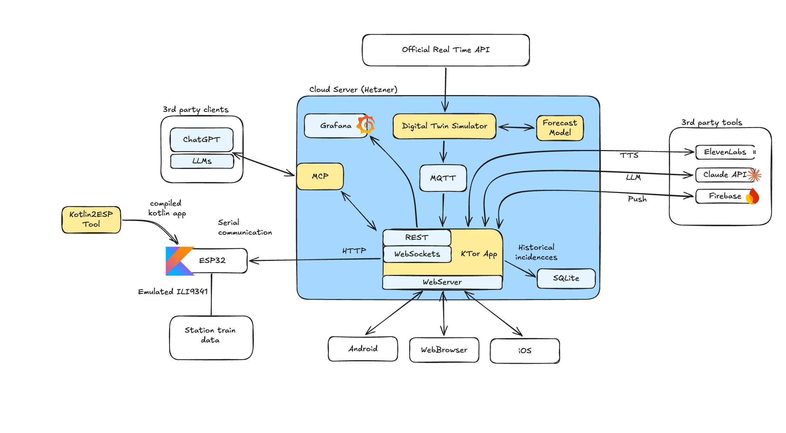

# Takt Application

**Takt** is the backend and the apps of [LauzTakt](https://github.com/LauzTakt), a real-time Swiss rail digital twin
built at LauzHack 2026. It turns the live state of the network (trains, delays, incidents) into information passengers
and staff can act on: on the web, in the Android and iOS apps, by voice, by push notification and on ESP32 station
screens.

## Architecture



This app is the **Ktor App** in the middle of the diagram:

- **In:** it reads the [sbb-twin](https://github.com/LauzTakt/sbb-twin) digital twin over **MQTT** (train info,
  fleet positions every second, incidents, status). It calls the twin over HTTP for its journey planner, situation and
  track geometry.
- **State:** live train state is kept **in memory only** (≈ 750 trains at 1 Hz). It rebuilds itself in a few seconds
  after a restart. **SQLite** stores what has to last: incident history, stations, staff users, reports and push
  subscriptions.
- **Out:** a REST API, WebSockets and the web server for **Android**, **iOS** and **web browser** clients. The
  [ESP32 station screens](https://github.com/LauzTakt/ktor-stationscreen) read a small plain-text feed over HTTP, and the
  [MCP server](https://github.com/LauzTakt/sbb-twin-mcp) exposes the data to ChatGPT, Claude and other LLM clients.
- **Third-party tools:** **Claude API** (travel assistant), **ElevenLabs** (voice), **Firebase** (Android push), Web
  Push (browsers and the iPhone Home Screen app).

Package layers and dependency rules: [docs/CODE_ARCHITECTURE.md](docs/CODE_ARCHITECTURE.md). Full system:
[docs/ARCHITECTURE.md](docs/ARCHITECTURE.md).

## Features

**For passengers** (public, mobile first)

- Live departure boards and train tracking: expected times, cancellations, skipped stops and incidents.
- **Best route from A to B.** The twin's planner suggests routes; each leg is checked against live state and our
  incidents, and the routes are ranked by expected arrival plus a risk penalty.
- **Push notifications:** follow a train (arrival at your stop and its incidents) or a whole line.
- **Travel assistant** powered by Claude, by text or voice (ElevenLabs). It knows which train, line or station is open
  on screen.
- **Tikt**, the train mascot: first-run tour, loading screens, and the face and voice of the assistant.
- Android and iOS apps (Capacitor) with deep links from shared links and station QR codes.

**For staff** (behind login)

- Live map of the whole fleet over WebSocket.
- Incident reports, user management, printable station QR codes.

**For developers**

- REST API v1 ([docs/API.md](docs/API.md), Swagger UI at `/swagger`) and WebSocket subscriptions to trains and
  stations.
- `GET /api/v1/stations/{id}/screen.txt`: about 250 bytes of text with an ETag, for microcontrollers.

## Tech stack

| Area | Technologies |
|---|---|
| Backend | Kotlin 2.4, Ktor 3.6 (Netty), kotlinx.serialization, Logback, JVM 21 |
| Data | Eclipse Paho MQTT, SQLite (WAL, one writer thread) |
| Web UI | Plain JS ES modules, MapLibre GL; voice assistant in React + Vite (`client/`) |
| Mobile | Capacitor (Android, iOS), Web Push (VAPID), Firebase Cloud Messaging |
| AI | Claude API (assistant agent with tools), ElevenLabs (voice agent) |
| Ops | Docker, Coolify on Hetzner, Grafana, GitHub Actions (CI, Android APK and iOS releases) |

## Project layout

```
src/main/kotlin/ch/lauzhack/twin/
  mqtt/        MQTT ingestion            state/      live train state (memory)
  db/          SQLite repositories       query/      read models: boards, journeys, incidents
  api/v1/      REST + WebSocket routes   routing/    best route A -> B
  assistant/   Claude travel assistant   passenger/  voice app endpoints, twin proxy
  push/        Web Push + FCM            auth/       staff login and tokens
  report/      staff incident reports    web/        fleet socket, app links
src/main/resources/static/   passenger web app and staff panel
client/                      voice assistant web app (React + Vite)
mobile/                      Capacitor Android / iOS apps
docker/                      Docker and Coolify deployment
```

## Run

```sh
export JAVA_HOME=$(/usr/libexec/java_home -v 21)
./gradlew test
./gradlew run                      # http://localhost:8080, API at /api/v1/status
./gradlew run -PskipClient=true    # without building client/ (no Node needed)
```

All configuration comes from environment variables. `./gradlew run` loads `.env` (template: `.env.example`, never
commit it). Main variables: `MQTT_BROKER_URL`, `MQTT_USERNAME`, `MQTT_PASSWORD`, `DB_PATH`, `SBB_TWIN_URL`,
`ANTHROPIC_API_KEY`, `ELEVENLABS_API_KEY`, `FCM_SERVICE_ACCOUNT_JSON`. The full list is in [CLAUDE.md](CLAUDE.md).

## Documentation

- [docs/ARCHITECTURE.md](docs/ARCHITECTURE.md): system overview
- [docs/CODE_ARCHITECTURE.md](docs/CODE_ARCHITECTURE.md): packages, layers, dependency rules
- [docs/API.md](docs/API.md): REST and WebSocket API v1
- [docs/DATA_SOURCE.md](docs/DATA_SOURCE.md): the sbb-twin MQTT feed
- [docs/STYLE.md](docs/STYLE.md): visual rules (SBB look)
- [docs/WALLET_TRIP_WATCH.md](docs/WALLET_TRIP_WATCH.md): wallet disruption alerts
- [docker/README.md](docker/README.md): Docker / deployment
- [mobile/README.md](mobile/README.md): mobile apps and deep links
- [CLAUDE.md](CLAUDE.md): contributor and agent notes

## Team

[Latra](https://github.com/latra) · [Dídac Cayuela](https://github.com/didicayu) ·
[David Sarrat González](https://github.com/davidsarrat) · [Sergi Simón Balcells](https://github.com/sergisi)
